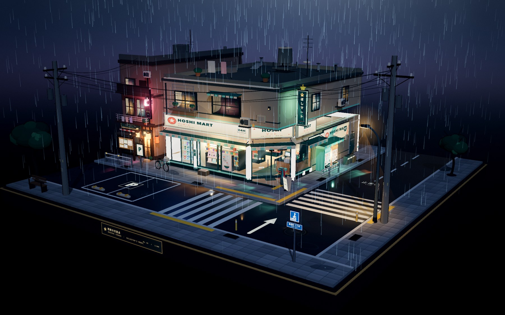
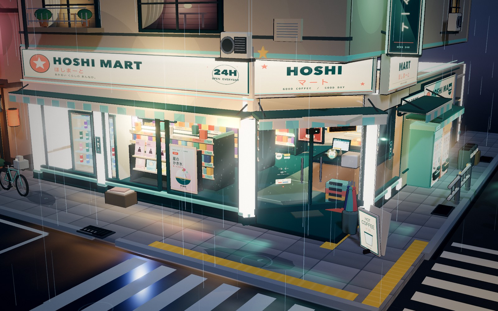

# HOSHI MART · 雨夜の交差点

一个雨夜日式便利店街角的微缩三维场景。以 Three.js 构建，采用三渲二材质、描边与霓虹夜景，整个场景坐落在一块完整的正方形收藏底座上。

可以自由拖拽旋转、滚轮 / 双指缩放，从任意角度观察街角、店内陈设与雨夜光影。没有任何叠加界面元素。



## 在线预览

**https://joruno-ai.github.io/hoshimart-diorama/**

也可以直接打开仓库中的自包含文件 [`index.html`](./index.html)。



## 场景内容

- **便利店**：大面积玻璃橱窗、自动门、雨棚、门口地垫、店招、竖向灯箱、24H 灯牌
- **店内**：多排便利货架与商品、瓶装饮料冷柜、杂志架、收银台、POS 屏、热食柜、关东煮、咖啡机、购物篮、海报与店内吊牌
- **街角**：斑马线、停车位、积水与反光、自动贩卖机、自行车、雨伞架、分类垃圾桶、街角护栏、路灯、电线杆与电线、排水沟、路牌、公告栏、空调外机、侧巷入口
- **环境**：细雨、路面水光、路灯光锥、霓虹反光、街树、屋顶晾衣绳、暖色咖啡店招牌
- **动画**：页面打开后从底座开始，墙体、玻璃、货架、招牌与街道物件逐层组装，随后店内亮灯、雨落下

## 交互

- 左键拖拽 / 单指滑动：旋转
- 滚轮 / 双指捏合：缩放
- 无任何 UI 按钮、面板或文字覆盖层

## 运行

已经生成好的版本直接打开 `index.html` 即可。页面是单文件、无外部网络依赖。

也可以启动本地静态服务器：

```bash
python3 -m http.server 5500
# 打开 http://127.0.0.1:5500
```

## 开发

```bash
npm install
npm run build   # 重新生成自包含的 index.html 和 dist/index.html
npm run dev     # 非压缩构建
```

构建使用 esbuild，将 Three.js、所有模块与程序化生成的 Canvas 纹理打包进一个 HTML 文件。

## 结构

```text
src/
  main.js        渲染器、灯光、相机、后处理与交互
  intro.js       组装动画时间线
  base.js        方形底座、街道、斑马线与积水反光
  store.js       便利店建筑、招牌、玻璃、店内陈设与灯光
  street.js      邻接咖啡店、侧巷、贩卖机、自行车、电线杆与街道家具
  weather.js     程序化雨幕、涟漪、蒸汽、天空与雾
  art.js         招牌、海报、杂志、灯箱等 Canvas 纹理绘制
  core.js        三渲二材质、描边、几何与画布工具
  index.template.html
scripts/build.mjs
docs/            预览图
```

## 技术要点

- MeshToonMaterial + 自定义反向外壳描边
- 程序化 Canvas 纹理生成所有日文招牌、海报、杂志封面与自动贩卖机画面
- Shader 驱动雨幕，带建筑体积裁切
- UnrealBloom、环境反射与自定义暗角/调色
- 完整的分组组装时间线
- 静态阴影冻结，渲染目标 DPR 上限 1.5，兼顾性能

没有人物。品牌、店铺、人物标识均为虚构。

## 致谢

- [Three.js](https://threejs.org/) — MIT License
